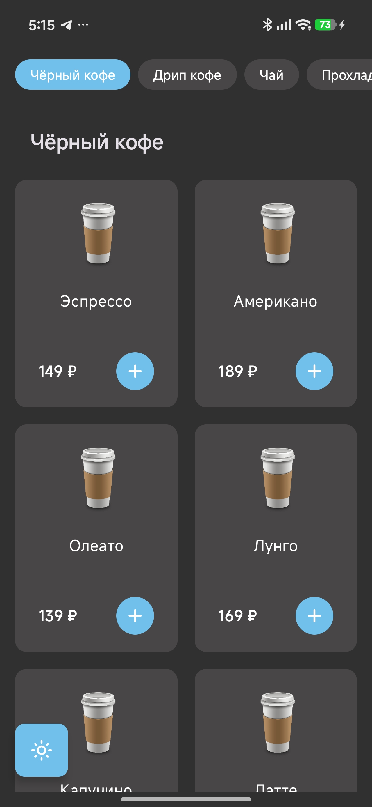
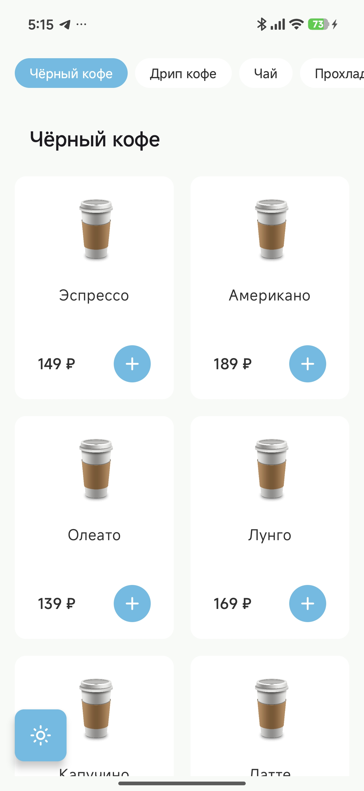
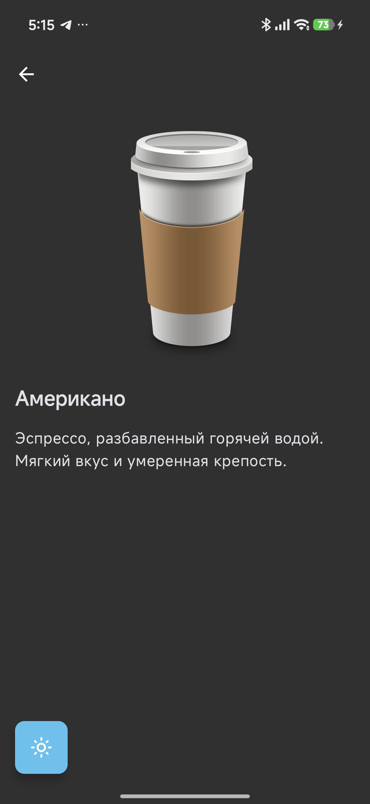
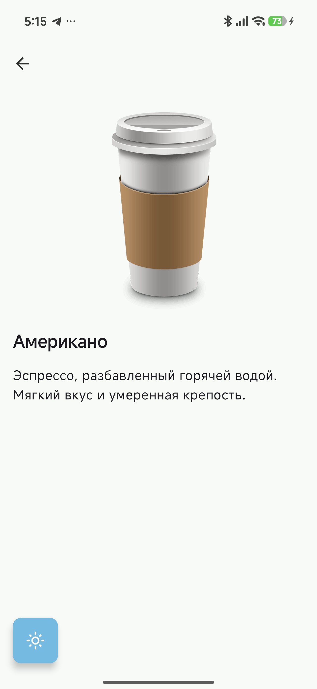
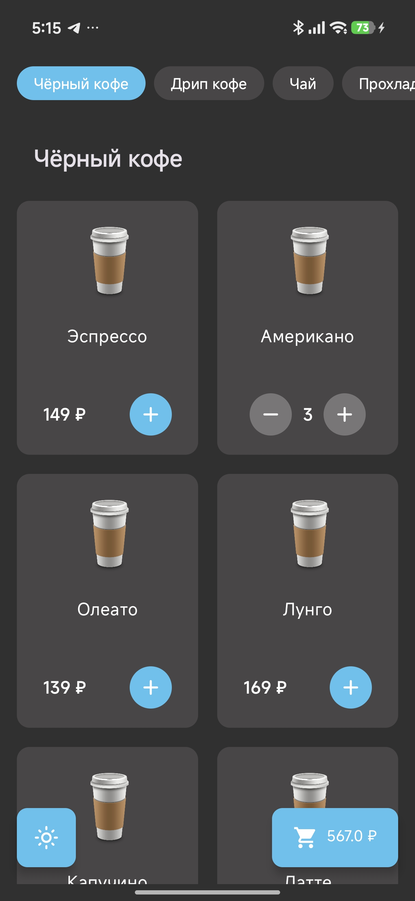
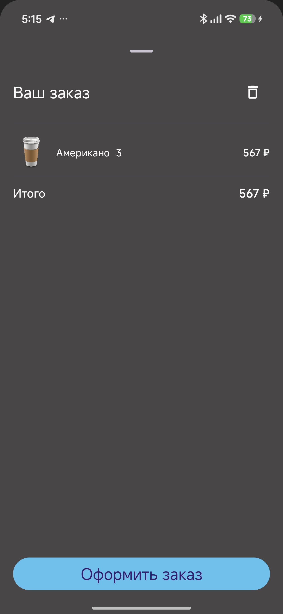

# RandomCoffee Swagger

Прототип приложения для заказа кофе из кофейни RandomCoffee.  
Тестовое задание для Студенческой лаборатории.


## Скриншоты
  
  

  
  




## Видео


## Стек технологий

| Что                          | Технология  |
|------------------------------|-------------|
| **Язык**                     | Kotlin Multiplatform |
| **UI**                       | Compose Multiplatform |
| **Архитектура**              | Clean Architecture (domain / data / presentation) |
| **DI**                       | Koin        |
| **Сеть**                     | Ktor        |
| **Навигация**                | Navigation Compose |
| **State**                    | ViewModel + StateFlow |
| **Изображения (AsyncImage)** | Coil        |


## Архитектура проекта

Проект построен по принципам Clean Architecture с разделением на части:

```
presentation/     — Compose экраны, ViewModels, UiState
domain/           — Use Cases, интерфейсы репозиториев, доменные модели  
data/             — Ktor API, DTO, реализации репозиториев
di/               — Koin модули
```


## Реализованный функционал

### Основное задание
- Загрузка товаров из сети с retry логикой
- Корректная обработка сетевых ошибок с возможностью повтора
- Отображение товаров сгруппированных по категориям 2 колонки
- Добавление товара в корзину, изменение количества
- Горизонтальная прокрутка категорий, всегда видимая поверх списка
- Переход на экран товара с описанием и ценой, возврат назад
- BottomSheet корзины — заказ, очистка корзины
- Ограничение на не более чем 10 штук товара
- Сохранение состояния корзины — корзина хранится на сервере, восстанавливается через `GET /cart` при каждом запуске

### Дополнительные задачи
- Автоскролл категорий — при скролле списка товаров активная категория автоматически появляется первой слева
- Две темы оформления — светлая и тёмная, с ручным переключением, выбор сохраняется после перезапуска


## API
Приложение использует API Swagger от Студенческой лаборатории: `https://coffee-backend.caravanlabs.ru`


## Структура проекта

```
commonMain/
├── data/
│   ├── api/              — Ktor клиент и API запросы
│   ├── dto/              — Data Transfer Objects + маппинги
│   └── repository/       — Реализации репозиториев
├── domain/
│   ├── model/            — Чистые доменные модели
│   ├── repository/       — Интерфейсы репозиториев
│   └── usecase/          — Use Cases (один класс — одно действие)
├── presentation/
│   ├── catalog/          — Экран каталога и BottomSheet корзины + ViewModel
│   ├── product/          — Экран товара + ViewModel
│   ├── theme/            — Цвета, темы
│   └── Navigation.kt     — Навигация приложения
└── di/                   — Koin модули
```

---

## Про Git

Старался следовать GitFlow, Conventional Commits:

```
master - финальная версия
develop - основная ветка разработки
feature/... - отдельная ветка на каждую фичу
```

Коммиты делал в таком стиле по **Conventional Commits**:
```
[feat]:     новая функциональность
[style]:    стили
[fix]:      исправление бага  
[refactor]: рефакторинг
[chore]:    зависимости, конфигурация
[docs]:     документация
```